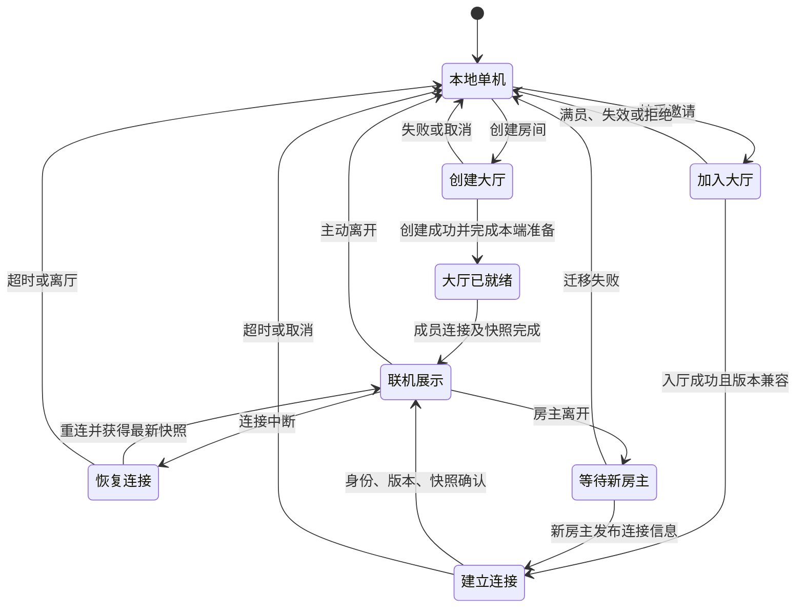

# 05 Steam联机与技术落地 原文

资料编号：ARCHIVE-05；归档修订：0.1；取回日期：2026-11-16。
规则状态：参考扩展／历史讨论原文，未定提案不是正式参数。

## 阅读前先看

- 来源聊天：一起摸鱼｜Steam联机与技术落地（01a1e003-a673-7281-853a-9f09dc63201a）；来源轮次：01a1e003-a6fc-7e22-bb9e-3b080535f673；来源消息：msg_0ef45e69f390661f016af9dc75b67087d0aaac0ff60109f94e。
- 下方“原文开始／结束”之间为工具取回的完整初版答复，按原文字序保留，未摘录或用目录代替正文。
- 原文中的“用户已定”“建议草案”和“待确认”保留其当时表述；当前状态以[版本对照](<06 跨专题修订与待定矩阵.md>)和[正式裁定记录](<../透明界面与跨专题同步 v0.2/00 阅读顺序与裁定记录.md>)为准。归档不批准原文的新增名称、数值、系统或方案。
- 本专题当前修订对应：05 Steam联机与窗口验收.md、09 同图多人选位与表现.md（均在“透明界面与跨专题同步 v0.2”目录，原路径保持不变）。
- Godot等引擎、4人/2—8人、20次/秒、本地权威、存档方案及迁移/离线政策均为历史技术候选，不是已批准实现。当前透明小窗、逐区域穿透、每人模式互斥、连续选位与多人位置/动作/收获以修订正文为准。B0题干另有开发方先做C#内核与Blazor网页原型的执行计划，应连同该批Q阅读；历史技术资料不代替开发对当前API的核验。

## 完整原文

<!-- 原文开始 -->
【建议草案】推荐采用 **Godot 2D＋薄层 Windows 原生适配＋Steamworks**，首版采用“房主协调公共场景、各端保存并结算个人鱼获”的结构。先验证穿透、不抢焦点、后台输入与 Steam 邀请能否同时稳定工作，再确定引擎版本和插件。

以下仅为技术策划讨论稿；未编写程序、修改文件、创建更多聊天或启动开发。技术资料按 2026 年 11 月 16 日核验，**文档支持不代表本项目组合已经实测通过**。

**【用户已定】本专题承接的范围如下。**

- Windows 桌面底部半屏或 1/4 画幅；卷轴式画面是参考方向，本稿不推断参考作品的具体实现。
- 键鼠输入触发路亚或下水摸鱼动作；手竿按时间获得鱼获。
- 路亚保留 500 次／50%、1000 次必上钩；摸鱼保留 200 次／20%、2000 次必中；手竿保留 30 分钟一条。
- 支持创建房间、邀请 Steam 好友加入。
- 鱼获可出售或收藏，金币用于抽外观，购买鱼缸扩充收藏容量；鱼有体长、收藏展示和记录页面。
- 首发三个地图。地图内容、人数、容量、定价及模式关系尚未确定。

**【建议草案】三条技术路线的比较如下；维护成本是相对判断，仍取决于团队已有经验。**

| 评审项 | Godot 2D＋Windows 扩展 | Unity 2D＋Windows 原生插件 | Electron＋Canvas/WebGL＋原生模块 |
|---|---|---|---|
| 透明、无边框、置顶 | 有相关窗口接口；透明效果受渲染器、驱动影响 | 窗口化可配置；透明、置顶作为原生适配工作验证 | 有透明、无边框、置顶接口 |
| 鼠标穿透 | **不能直接承诺跨软件穿透**；需 Windows 适配实验 | 需验证窗口样式与渲染表面兼容性 | 有整窗忽略鼠标接口；透明像素不会天然穿透 |
| 高 DPI、多屏 | 有显示器与缩放接口；跨屏仍需实测 | 需统一引擎与原生坐标、验证跨 DPI 行为 | 有屏幕、缩放和显示器变化接口 |
| 后台键鼠统计 | 接 Windows Raw Input | 接 Windows Raw Input；后台运行设置不能代替输入采集 | 浏览器事件不足，仍需原生模块 |
| 2D 动画、场景 | 适合精灵、骨骼、粒子和场景编辑 | 适合；已有 Unity 团队可优先 | 可以实现，但游戏编辑流程需另行组织 |
| Steam 集成 | 需维护兼容的绑定或自有封装 | 同样需要绑定或封装 | 需要原生桥接，并额外验证 Overlay |
| 维护成本判断 | 中；重点维护 Windows、Steam 两个边界 | 中；熟悉 Unity 时可降低成本 | 中高；同时维护网页、桌面桥接及原生依赖 |

核验到的关键限制：

- Godot 文档明确说明：Windows 下 `window_set_mouse_passthrough` 的区域外部分还会停止绘制；`WINDOW_FLAG_MOUSE_PASSTHROUGH` 描述的是向**同一应用**下层窗口传递鼠标，不能据此承诺穿透到办公软件。[Godot DisplayServer](https://docs.godotengine.org/en/4.6/classes/class_displayserver.html)
- Unity 支持桌面原生插件；`Run In Background` 只说明失焦后继续运行，不足以证明可以统计其他应用中的键鼠操作。[Unity 桌面插件](https://docs.unity.com/en-us/engine/6000.0/manual/programming-environment/plug-ins/for-desktop)、[Windows Player 设置](https://docs.unity.com/en-us/engine/6000.0/manual/platform-specific/windows/playersettings)
- Electron 有 `setIgnoreMouseEvents`，但透明窗口存在调整大小等限制；原生模块可能需要随 Electron 的 ABI 重新编译。[鼠标忽略接口](https://www.electronjs.org/docs/latest/api/browser-window/#winsetignoremouseeventsignore-options)、[透明窗口限制](https://www.electronjs.org/docs/latest/tutorial/custom-window-styles)、[原生模块](https://www.electronjs.org/docs/latest/tutorial/using-native-node-modules)

【建议草案】如果团队没有既有引擎优势，优先验证 Godot；如果核心成员已经熟悉 Unity，则先在 Unity 做同样实验，不为理论上的轻量优势承担换引擎成本。Electron 可作为网页技术团队的备选，但 Steam Overlay 官方对浏览器式渲染另有要求，不能假定普通 Electron 窗口直接满足。[Steam Overlay](https://partner.steamgames.com/doc/features/overlay)

**【建议草案】桌面窗口采用“陪伴显示”和“管理操作”两种状态。**

| 状态 | 行为 |
|---|---|
| 陪伴显示 | 底部显示场景，不抢键盘焦点；可切整窗鼠标穿透；键鼠反馈来自独立统计通道 |
| 管理操作 | 用户主动打开收藏、记录、设置等面板，接受正常点击和键盘输入 |
| 临时隐藏／最小化 | 隐藏画面、降低渲染负担；输入统计和手竿是否继续由明确开关控制 |
| 应急恢复 | 托盘菜单提供关闭穿透、恢复窗口、暂停反馈和退出，避免穿透后无法操作 |

半屏和 1/4 暂按“**所选显示器可用工作区高度**”解释，宽度默认铺满该显示器工作区；这是建议，不是用户已确认的画幅定义。默认避开任务栏，不自动挤压其他软件窗口。

Windows 适配层负责显示器选择、置顶、焦点、穿透及坐标转换；游戏层负责布局和动画。记录显示器标识与相对位置，显示器拔除后回到可见工作区。高 DPI 使用统一逻辑坐标，原生边界处才转换物理像素；跨屏时同步更新窗口尺寸和点击区域。微软提供逐显示器 DPI 通知与各显示器工作区接口，但具体引擎组合必须验证。[高 DPI 官方说明](https://learn.microsoft.com/en-gb/windows/win32/hidpi/high-dpi-desktop-application-development-on-windows)、[多屏窗口定位](https://learn.microsoft.com/en-us/windows/win32/gdi/positioning-objects-on-multiple-display-monitors)

Windows 分层窗口有向下层窗口传递鼠标的机制，但它与引擎渲染表面是否兼容，是实验项，不能简化成“加一个标志就一定成功”。[Windows 分层窗口说明](https://learn.microsoft.com/en-us/windows/win32/winmsg/window-features)

**【建议草案】后台输入只产出动作事件，不形成按键记录。**

建议的数据链为：

**系统输入通知 → 最小化过滤 → 本地动作计数 → 玩法判定 → 动画反馈／鱼获事务。**

Windows Raw Input 可通过 `RIDEV_INPUTSINK` 接收后台输入；统一由一个模块注册，避免与引擎输入重复计算，不使用拦截或屏蔽其他软件输入的配置。[Raw Input](https://learn.microsoft.com/en-us/windows/win32/inputdev/about-raw-input)、[注册标志](https://learn.microsoft.com/en-us/windows/win32/api/winuser/ns-winuser-rawinputdevice)

最小数据约束建议为：

- 玩法层只接收 `动作序号、动作来源类别、单调时间`，不接收键名、字符或扫描码。
- 不转换文本，不访问剪贴板，不收集窗口标题、应用列表或鼠标位置。
- 不保存、上传逐次输入时间线；存档只保存累计进度。
- 网络只发送合并后的角色动作表现，不发送原始键鼠事件。
- 后台统计、键盘反馈、鼠标反馈分别提供开关；首次开启说明用途，关闭后注销后台接收。

【待确认】如果需要排除“长按产生的系统连发”，适配层可能需要在内存中短暂辨别同一个键的按下／释放，随后立即丢弃标识。这不形成文本内容，但不能称为“完全不接触键标识”。若要求连瞬时键标识也不处理，则难以准确区分连发。

建议暂以“按下一次”为计数单位，释放、鼠标移动和滚轮不计；游戏管理界面的操作不产生钓鱼收益。两项均需玩法确认。

| 电脑状态 | 建议处理 |
|---|---|
| 游戏失焦，正在办公 | 后台统计已开启时正常反馈 |
| 游戏管理面板／Steam Overlay 打开 | 暂停主动收益计数，避免菜单操作刷进度 |
| 电脑空闲但未锁屏 | 主动模式无输入；手竿按选定规则继续 |
| 锁屏、睡眠、休眠 | 停止主动统计；手竿暂按暂停处理，最终取决于离线收益政策 |
| 恢复使用 | 清空临时按下状态、重置时间基准，不回放积压输入 |

【建议草案】速率保护先提供**每秒 20 次有效输入**的可调测试值；超出后不积压奖励动作。这会改变高频输入的收益，应单列为规则建议。动画可以缩短或融合表现，但有效输入计数不能因帧率下降而丢失。

脚本、虚拟设备、硬件宏与人工操作无法可靠完全区分。速率限制和异常检测只能限制收益速度；本地存档方案也无法保证防改档，不以“完全防作弊”为验收目标。

**【建议草案】三种玩法共用判定接口，先保留规则选择能力。**

| 歧义 | 可选解释及后果 | 推荐的原型假设 |
|---|---|---|
| 每次输入都有概率，还是到次数才判定 | 每次都抽需要补充基础概率及其与保底的关系；节点判定更容易准确复现现有数字 | 采用节点判定；其他输入仍有动作反馈 |
| 路亚节点 | 500 次成功后是否重置，影响 1000 次如何计算 | 500 次判定 50%；失败继续到 1000 次必得；成功重置 |
| 摸鱼节点 | “200 次一次”是否表示每隔 200 次重试 | 200、400……1800 次各判定 20%；此前均失败则 2000 次必中；成功重置 |
| 切模式／切地图 | 共用计数便于切换，但可能携带进度去另一地图；分开计数更可控 | 按“模式＋地图”保存，切换时冻结原进度 |
| 三种模式关系 | 全互斥收益较低；手竿并行会增加总产出；两种主动同时结算会让一次输入获得双份进度 | 原型暂用三选一，架构支持后续改成“一个主动＋手竿” |
| 手竿计时 | 按帧累加受卡顿影响；直接用系统时钟容易受改时间影响 | 使用有效运行时长，满 1800 秒一次；余数保留 |

这些都是可替换的原型假设，**没有替换用户的次数、概率或 30 分钟基线**。

玩法接口至少包含：`mode_id、map_id、rules_version、有效输入增量、有效时长增量、计数周期、已处理判定节点`；输出包含动作反馈、判定结果和待入账奖励。判定失败同样持久化，避免正常重启后对同一节点重新抽取。

**【建议草案】Steam 联机分成四层，明确谁负责什么。**

| 层 | 职责 | 不承担的职责 |
|---|---|---|
| Steam 大厅 | 成员、邀请、人数上限、版本与房主发现 | 不视为已经建立游戏连接 |
| 网络连接 | 身份校验、握手、消息和断线检测 | 不直接修改个人库存 |
| 公共场景与动画 | 地图、座位、角色外观、动作和鱼获展示 | 展示消息不能发钱、发鱼 |
| 个人玩法与存档 | 自己的计数、随机判定、鱼获、金币、收藏 | 不由房主代存 |

权威模式的取舍：

| 方案 | 优点 | 成本与适用性 |
|---|---|---|
| 房主结算所有鱼获 | 房间内较易统一规则 | 房主仍可作弊；离线单机、断线、主机迁移需要收益交接 |
| **各端结算个人鱼获** | 单机与联机逻辑一致，断线不影响自己的收益 | 无法证明别人展示的鱼真实获得；适合首版陪伴体验 |
| 常驻服务器结算 | 可提供更强的一致性和审计 | 增加账号、服务、运维和持续费用；本稿不纳入首版 |

【建议草案】采用第二项；房主只协调公共场景。房间人数先以 **4 人**验证，配置预留 2—8 人；8 人是否开放取决于画面拥挤度、性能和网络测试，不是用户已定人数。首版可先做邀请制房间，暂不扩大为公开匹配。

**【建议草案】房间状态流程如下。**

其中“本地单机”始终可以继续个人玩法，连接恢复只暂停多人展示。

| 场景 | 具体流程 |
|---|---|
| 创建 | `CreateLobby` → 等成功结果 → 准备监听连接 → 发布协议版本、地图、房主、房间代次和容量 → 开放邀请 |
| 邀请 | 通过 Steam 好友邀请能力发出邀请；发送成功不等于好友已加入 |
| 游戏内接受 | 接收 `GameLobbyJoinRequested_t`，先完成当前本地事务，再加入目标大厅 |
| 游戏未启动时接受 | 处理启动参数 `+connect_lobby`，加载存档后进入同一加入流程 |
| 加入 | `JoinLobby` → 检查 `LobbyEnter_t` → 校验协议与内容版本 → 连接当前房主 → 校验成员身份 → 获取快照 → 显示成员 |
| 重连 | 保留个人进度，丢弃旧连接；重新读取大厅成员及房主，建立新连接；成功后用快照替换旧展示 |
| 主动退出 | 停止发送展示、退出大厅并关闭连接；个人存档照常保留 |

创建、入厅和邀请入口均有官方 API；它们仍需要游戏自行组织异步结果与失败状态。[Steam 大厅流程](https://partner.steamgames.com/doc/features/multiplayer/matchmaking)、[Steam Matchmaking API](https://partner.steamgames.com/doc/api/ISteamMatchmaking)

【建议草案】传输层优先使用 `ISteamNetworkingSockets` 的 P2P 连接及 Steam 中继能力，依据连接状态回调处理失败，不承诺所有网络都能连接。即使画面隐藏或正在加载，也要继续处理 Steam 回调。[Steam Networking Sockets](https://partner.steamgames.com/doc/api/ISteamNetworkingSockets)

房主离开须分两种情况：

- **正常退出：**先进入迁移状态，移交大厅所有者；新房主准备监听、发布新房间代次，其他成员重新连接。
- **崩溃／断网：**等待 Steam 确认当前大厅所有者；新所有者重新建立监听和发布状态。旧房主回来后按普通成员处理，不自动夺回控制权。

Steam 会在大厅所有者离开时自动指定新所有者，**游戏连接与场景迁移必须另做**。[大厅所有者规则](https://partner.steamgames.com/doc/api/ISteamMatchmaking#GetLobbyOwner)

建议使用 `room_epoch＋connection_session_id＋消息序号` 拒绝旧连接消息；新房主必须与当前 Steam 大厅所有者一致。迁移失败时回到本地单机并保留“重新加入”入口，不能无限显示连接中。

【建议草案】离线单机包含“Steam 在线服务不可达”和“Steam 初始化失败”两条分支。前者加载已知账号存档继续玩；后者如允许启动，则使用独立本地档，恢复登录时不能自动合并金币和鱼获。Steam 初始化确实依赖客户端、App ID、账号上下文等条件，不能把 SDK 示例中的退出逻辑当作本游戏必须采用的产品规则。[Steam 初始化条件](https://partner.steamgames.com/doc/api/steam_api)

**【建议草案】仅同步陪伴展示所需状态。**

| 数据 | 同步方式 |
|---|---|
| 房间地图、座位、房主代次 | 房主发布可靠状态；加入及重连发送完整快照 |
| 角色、装备和场景外观 ID | 可靠更新，接收端检查资源 ID |
| 当前模式、角色动作 | 合并后的动作消息，可丢弃旧动作，不追补历史输入 |
| 钓到鱼的展示 | 已本地入账后发送：事件 ID、鱼种、体长及展示信息 |
| 金币、完整鱼获库存、图鉴、收藏布局、计数器 | 只保存在本人本地，不上传给房主 |

个人收藏暂不支持好友浏览；若之后提出该功能，另加只读展示快照接口。

避免重复入账的核心约束是：**网络展示事件没有奖励权限。**重复收到“某玩家钓到鱼”只能去重显示，不能给任何库存新增鱼。

**【建议草案】存档采用本地事务存储，首版可评估 SQLite；存档合同至少包括以下字段。**

| 对象 | 必要字段与约束 |
|---|---|
| 档案头 | `profile_id、owner_binding、schema_version、content_version、rules_version、revision` |
| 个体鱼获 | 全局唯一 `fish_id`、`species_id`、整数 `length_mm`、地图、获得模式、奖励事务 ID、持有状态 |
| 图鉴与记录 | 鱼种发现状态、累计捕获次数、最大体长及对应鱼获 ID；卖鱼不删除历史记录 |
| 货币 | 币种、整数余额、事务 ID、金额变化和来源；余额不能靠展示消息累加 |
| 库存与外观 | 物品定义 ID、数量或实例 ID、已解锁外观、当前装备 |
| 收藏容器 | `container_id、container_type_id、capacity_rule_id、鱼获引用、布局、背景选择` |
| 主动计数 | 模式、地图、计数周期 ID、有效次数、已判定节点、规则版本 |
| 手竿计时 | 计时周期 ID、累计有效毫秒、已结算区间序号、余数、计时政策版本 |
| 事务与恢复 | 操作 ID、处理结果、档案修订号、必要的日志与备份信息 |

体长以同一个 `length_mm` 驱动记录数值和鱼缸显示，按鱼种配置“毫米到显示尺寸”的关系。大鱼超出画幅时提供缩放或放大查看，不能把所有鱼统一拉成同样大小。这里的“实时体现”暂解释为实时展示已获得体长，**不新增养鱼生长系统**。

鱼缸容量通过 `capacity_rule_id` 预留按条数、体积或其他单位计量的能力；具体规则由收藏专题确定。

事务规则建议为：

- 获得鱼：生成唯一奖励键 → 记录判定 → 新建鱼获 → 更新计数／计时 → 一次提交，提交成功后播放获得反馈。
- 出售：同一事务验证鱼仍可出售、改变其状态并增加金币；重复操作返回原结果。
- 放入或移出鱼缸：验证鱼归属、容器容量和预期修订号，再一次提交；同一条鱼不能同时在两个容器。
- 抽外观或购买鱼缸：扣款、随机结果或新容器在同一事务完成；抽取规则和重复物品处理只作为外部配置接口。
- 【待确认】已收藏鱼能否出售。数据结构保留该能力，规则未定前不擅自开放。

普通输入进度建议每 5 秒保存一次，奖励、出售、抽取、容器变更立即提交；因此崩溃可能损失最近最多约 5 秒的未保存输入，但**已经提交的鱼获和货币不得重复或丢失**。若要求连最后一次输入都保留，需要更频繁持久化并评估开销。

版本迁移要求：稳定 ID 不随资源改名变化；逐版迁移、迁移前备份、迁移失败恢复原档；新版档案不允许旧版直接覆写。余额和鱼获不能只按“哪个时间戳更新”合并。若未来增加 Steam Cloud，分叉档案先保留双方并选用完整版本，不自动相加。

**【待确认】离线收益有三种可行政策。**

| 政策 | 成本与代价 |
|---|---|
| **仅程序运行且会话有效时计时，建议首版采用** | 最容易解释和验证；退出、锁屏、睡眠均暂停；无输入但未锁屏仍可手竿挂机 |
| 允许退出或睡眠后的有限补算 | 需定义上限、地图归属、时钟回拨处理；依赖本机时间，无法可靠防改钟 |
| 依赖可信服务时间结算 | 可加强时间依据，但引入服务和断网补偿流程；不应直接扩展为必需常驻服务器 |

无论采用哪项，都要用“已结算区间序号”防止同一段 30 分钟重复领取；不能在恢复电脑时简单把系统时间差全部加进去。

**【建议草案】从技术实验到 MVP，按依赖顺序推进。**

| 阶段 | 产出与进入下一阶段的条件 |
|---|---|
| 先验证桌面边界 | 一个角色即可；验证透明、置顶、穿透、不抢焦点、后台输入、高 DPI、多屏与 Steam Overlay 的组合 |
| 纵向可玩原型 | 一张占位地图、一种鱼，三种模式均可切换；完整走通输入／计时→鱼获→出售／收藏→重启恢复 |
| Steam 双人原型 | 两个真实账号验证建房、邀请、冷启动加入、重连和房主离开；个人收益不依赖连接 |
| MVP | 接入三个地图的数据与资源、图鉴、体长显示、容器扩展、外观抽取接口、迁移与恢复；按建议人数做性能验证 |

不据此承诺确定工期。实验结果、团队的引擎与原生开发经验、美术交付方式和预算，才是估算依据。

必须先做的实验及可执行验收场景：

| 实验／验收 | 通过条件 |
|---|---|
| 底部 1/4 窗口上方连续办公 | 打字不丢失、不重复、不抢焦点；穿透时可点击画面下方其他软件；托盘能恢复操作 |
| 100%、150%、200% 缩放之间跨屏，并拔掉副屏 | 画面、文字、点击区域一致；窗口始终能找回 |
| 后台输入与长按 | 在原型假设下，100 次独立按下只增加 100；前台／后台切换不双计；连发行为符合已选政策 |
| 阈值判定 | 固定测试随机结果，验证路亚 499→500 失败→1000 必得；摸鱼全部失败路径到 2000 必得 |
| 手竿边界 | 1799 秒不发，达到 1800 秒只发一条；暂停、恢复、改系统时钟、重启不重复发 |
| 保存期间强制终止进程 | 重启后只存在提交前或提交后的完整状态，不出现“加钱但鱼仍可再卖”等半完成状态 |
| 两账号邀请 | 游戏内接受、未启动时接受、房满、邀请过期、版本不兼容都有明确结果 |
| 断线与房主退出 | 重连获得最新展示；旧动作不补播、旧连接消息无效；迁移失败仍能继续个人玩法 |
| 隐藏、最小化和切地图压力 | Steam 回调持续处理；输入队列有界，不恢复后集中发放；记录 CPU、GPU、内存与功耗，再确定性能预算 |

**【待确认】目前最影响技术结构的四项选择如下；各项已有推荐假设，讨论可直接从这些假设修改。**

1. **判定规则：**采用上表节点判定，还是每次输入都抽取并叠加节点／保底？后者需要补充基础概率及优先级。
2. **模式与进度：**三选一，还是主动模式与手竿并行？切地图是否携带计数？建议原型三选一、按模式与地图冻结进度。
3. **本地权威是否可接受：**建议个人鱼获本地结算、多人只展示；若要求统一可信经济或竞技，需要重新评审权威结构。
4. **挂机和输入边界：**退出／锁屏／睡眠是否补收益，长按是否计数，是否接受速率上限？这些会直接影响计时、隐私说明和收益测试。

跨专题目前只需要提供字段合同：三个地图的稳定 ID 与鱼池版本；鱼种 ID、体长范围和显示比例；容量规则；出售资格与估价接口；外观及抽取配置。具体内容均未视为已通过决议。
<!-- 原文结束 -->

## 归档记录

0.1 / 2026-11-16 / 取回并保存初版完整正文，附当前规则适用边界 / 用户要求补齐仓库缺失原文 / 仅资料归档，未程序接入。
