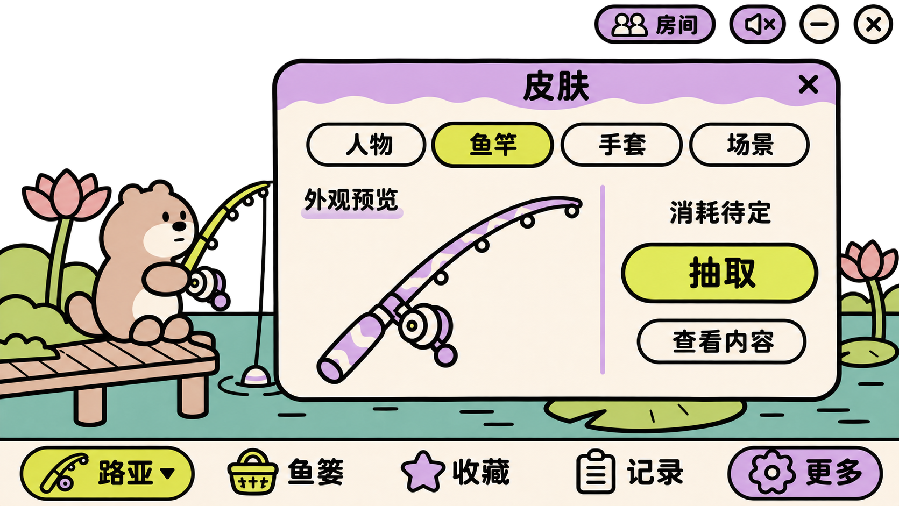
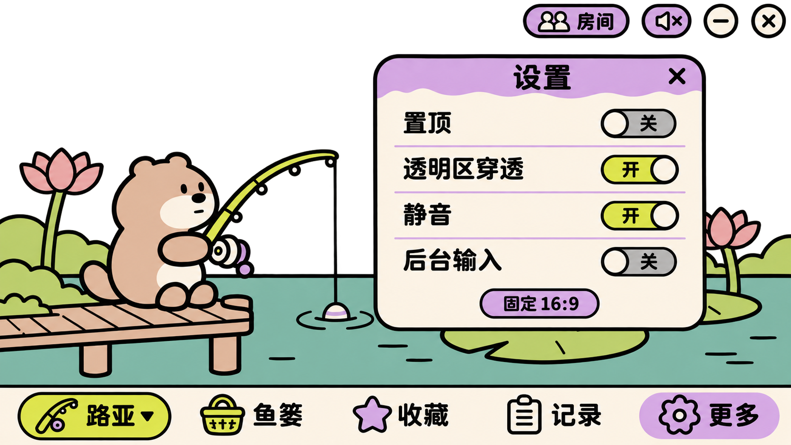
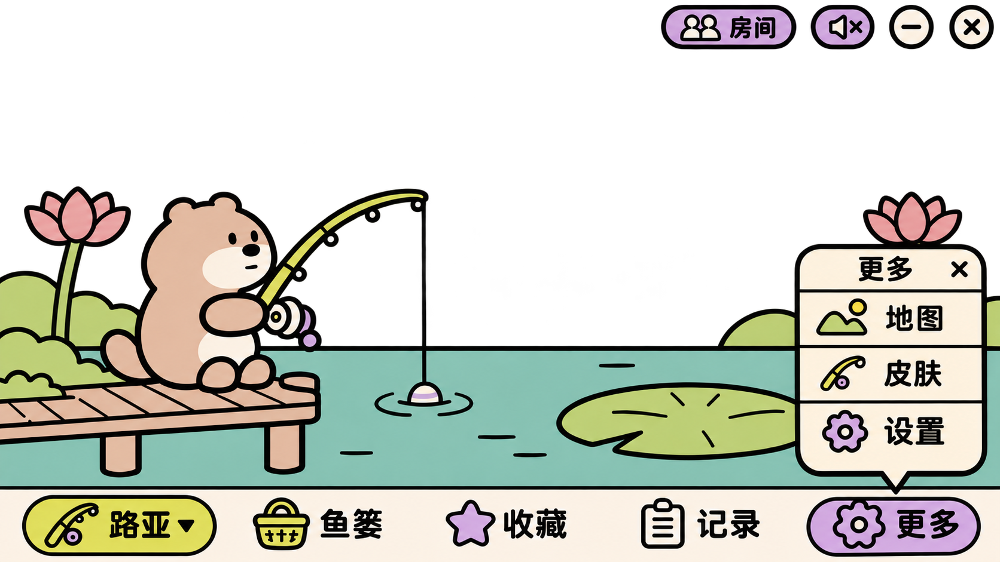
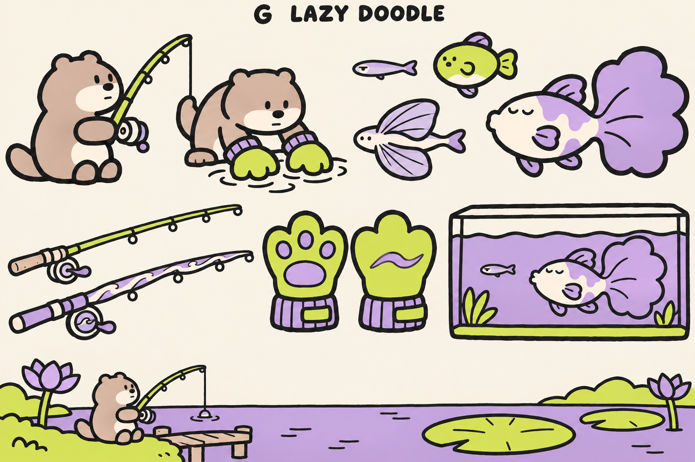

# 美术资产与参考图

系统编号：ART-001；单案修订：0.6；更新日期：2026-11-17。
规则状态：已选G风格与UI布局的制作参考；具体角色设定与物种内容未全部锁定。

2026-11-17后续裁定：B0/B1已完整答复，手竿真实计时、记录未知“？”、卡片＋新鱼数、原画幅底层鱼缸及资源职责按[网页Q交接](<../网页核心循环 v0.1/08 B0-B1答复与开发差异.md>)执行；本轮具体玩家原句已由总控按用户明确授权补齐至[文案定稿](<../文案交接 v0.1/03 B0-B1界面文案定稿.md>)，优先于本目录旧“待文案定”状态，不冒充shioko0315本人确认。原有实现同步/修改记录保留，完成情况以开发接入后的实际验收为准。

B3后续裁定（2026-11-17）：[同图房间正文](<../同图房间 v0.1/01 房间规则与模拟陪伴.md>)已落实Q14—Q22：网页仅本机模拟、4人含房主、房主切图/自动迁移、确认断线0秒释放、各人装备、全房房主主题/背景缸、好友收获动作/卡片/可静音声音及只读好友当前背景缸。Q16用户交开发方定，推荐各端个人结算；模拟不能代替PC真实并发/断线/迁移证据。[B3文案04](<../文案交接 v0.1/04 B3房间文案定稿.md>)已按用户Q22授权总控补齐。本目录原相关待定说明由此后续裁定取代，原文/开发记录保留。

## 1. 目标、职责与边界

采用G粗笔涂鸦方向，参考图作为构图、层级、轮廓和配色依据。保留原A—L评审作为历史，不把它们继续列为当前未选择风格；不覆盖原评审资料。

当前透明版优先于早期G板的紫色水面。采用参考中的原创伙伴识别特征，但不借此确定种族、角色名字或世界观，也不宣称已有商业IP授权。

## 2. 制作顺序

Q3/Q12已明确由开发方整理/制作分层占位及区域数据：沿G母版制作六鱼、12可抽外观与4默认、手竿/摸鱼姿态和连续岸边/浅水。先锁母版 → 分层制作 → 接入动作/面板 → 小窗检查 → 验证DPI/桌面底色。保持16件可区分，三场景为暖灯/细雨/月光叠加，标明美术临时素材；正式素材只替换资源，不清鱼获/已获外观。Q11背景为原画幅内底层鱼缸，不是地图水面的观赏鱼。

不要逐张重生所有角色来充当连续动画；输入动作通过同一批准母版派生，鱼获卡、鱼篓、收藏、图鉴引用同一鱼种资产。

## 3. 分层交付与命名语义

角色身体/头/前爪、摸鱼手套、鱼竿/线/浮漂、鱼、水面、岸边/装饰、主栏、右上独立控件、次级卡片、图标与文字分别交付。鱼体资源提供长度标定，所有个体用统一尺度驱动。

命名/文字母版【交文案策划定】；源文件层名可使用内部稳定ID，不把临时图中文字烘焙进正式控件。

## 4. 图像不变量与规则

- 粗黑略不规则轮廓、简化形状、克制表情、大色块。
- 留白真正透明；黑轮廓和角色奶油色块完整。
- 主栏与菜单实体区域正式制作时完全不透明；透明开关只影响命中，不改变美术alpha。
- 荷塘青绿水、自然绿叶、柔粉花；紫色只作少量UI/鱼体点缀。
- 左上无标题、无九点、无整条顶栏底板；顶右四个控件独立。
- 窗口几何固定16:9，生图宽高取整不决定实际窗口规格。

## 5. 参考图与菜单

所有图中文字、示例鱼名/长度、两人/两缸都仅为排版示例，均【交文案策划定】。08已补入用户选择的地图入口；09是新补的选择面板，三个占位名称不构成地图题材裁定。

### 透明主界面与鱼获轻提示

### 三种互斥模式入口

### 好友房间

### 鱼篓与主动处置入口

### 收藏室管理与背景预览

### 图鉴与尺寸记录

### 外观预览与抽取入口

### 设置与默认开启的穿透开关

### 更新后的更多菜单，包含地图

### 三地图选择，名称为占位

早期G风格板仅用于画法与原始轮廓参考，水色/窗口以当前UI为准：

## 6. 原图适用边界与生产统一

2026-11-16用户补充同图多人后，本页原图继续仅作已选风格、透明窗口及菜单参考，尚未覆盖完整多人构图。后续地图图稿需展示同图本人/好友同时活动、连续岸边落座范围、连续浅水摸鱼范围和各自收获归属；不为每位好友单画专用钓台，不用房间列表替代场景角色。

按09交付可用区域边界与地图版本，并按用户已定4人（含房主）验证三图全员岸钓、全员摸鱼、混合模式的角色、装备、动作及收获提示空间。不得用旧两人图声称4人满员容量通过；不在本次修改中重生成图片或将PNG视为运行证据。

玩家应能尽量靠近；保持角色与收获归属可辨，不把每位玩家的整片竿线/水花效果画成独占空地，也不通过强制大间距替代多人层次设计。

这些是AI效果图，不是可直接切图或运行的界面。部分菜单图里的角色尺寸、鱼形细节、线宽与底栏边距存在漂移；正式制作固定角色世界尺寸与共用底栏，不因打开面板把角色变成不同大小。面板允许遮挡部分场景，关闭后还原。

参考PNG的背景alpha已检查，但部分实体像素为253—254等近不透明值；正式控件使用完全不透明实体填色，抗锯齿边缘保留必要半透明。热区使用语义区域，不以AI毛边阈值自动决定。

原图1671/1672×941等宽高有取整偏差。实际窗口与制作画板按16:9执行，480×270是100%缩放下布局例子，不照搬原图像素为控件规格。

## 7. 资产记录与来源

- 本目录assets/ui为当前10张UI参考；assets/G-early-style-reference.png为早期G辅助板。
- [生成提示词记录](assets/生成提示词记录.txt)保留透明版初始生成记录。
- [补图提示词记录](assets/补图提示词记录.txt)保留新增地图入口与地图选择的提示词。
- [资源检查记录](assets/资源检查记录.md)列出尺寸、alpha检查和文件摘要。
- 生成方式为内置image_gen；PNG原始输出复制保留，没有用代码重画或改色。

## 8. 美术验收目标

- ART-01：在浅、深、复杂底色下透明空隙无整块底板，角色/卡片内部不误透明。
- ART-02：角色与装备母版跨动作一致，手套不会在不该出现的姿态自动新增。
- ART-03：同鱼种跨鱼获卡/鱼篓/收藏/记录保持同一鳍尾与识别色。
- ART-04：模式可由拉竿、探水、竿架等待三种姿态区分。
- ART-05：实际480×270示例下控件、鱼获和手套/竿尖可辨，字号不依赖放大图。
- ART-06：正式文字可替换、主栏/面板实体不透明、动作与反馈分层可复用。
- ART-07：同镜头鱼体长度比例与数据一致，缩略图不冒充实物比例。
- ART-08：更多菜单有地图入口；无左上标题/九点/整条顶栏。
- ART-09：多人地图图稿显示连续岸边与浅水范围，包含自动安排/主动选位的空间，不画成每人独立钓台。
- ART-10：最终满员构图能辨认各成员的模式动作与收获归属，角色和装备母版尺度不因好友加入而漂移。

## 9. 待定与来源

本轮已定六种临时鱼的视觉语义，以及12款可抽＋4类默认外观，制作清单见[网页皮肤内容](<../网页核心循环 v0.1/04 出售与皮肤内容提案.md>)；本轮分层素材按用户既有安排由开发完成。完整转面、连续动画、声音、正式扩展及逐字命名仍待制作/文案，现有PNG不能代表新动作/皮肤已实现。计划验收不等于已实测。

来源：美术选型会话、桌面界面会话、本轮三项用户答复及00裁定。

## 修订记录

0.2 / 2026-11-16 / G透明版为当前母版方向，补地图参考，保留文案和内容边界 / 用户选版 / 全专题 / PNG参考已生成，正式分层未制作。

0.3 / 2026-11-16 / 标明旧图多人覆盖不足，新增连续区域、满员动作和收获构图要求 / 用户补充 / 地图、UI、联机 / 多人图与程序均未制作。

0.4 / 2026-11-16 / 接入网页核心循环已答复规则与委托协调售价，相关旧未定指向新版正文 / 用户改进及各专题协调 / 输入、地图、经济、界面与技术 / 本轮仅策划交接，未改源码。

0.5 / 2026-11-17 / Q3/Q12明确开发制作分层占位与六鱼16外观，Q11底层鱼缸在原画幅内 / 用户完整答复 / 正式资源可替换，资产不清。

0.6 / 2026-11-17 / Q15按4人三图构图、Q20房主公共主题/缸及逐人装备、Q21收获动效引用 / 用户完整答复 / 不重生成旧参考PNG。
