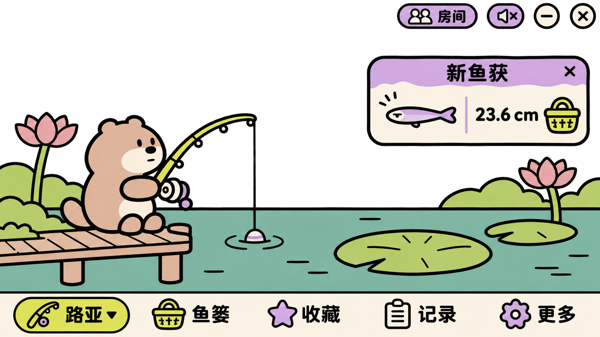
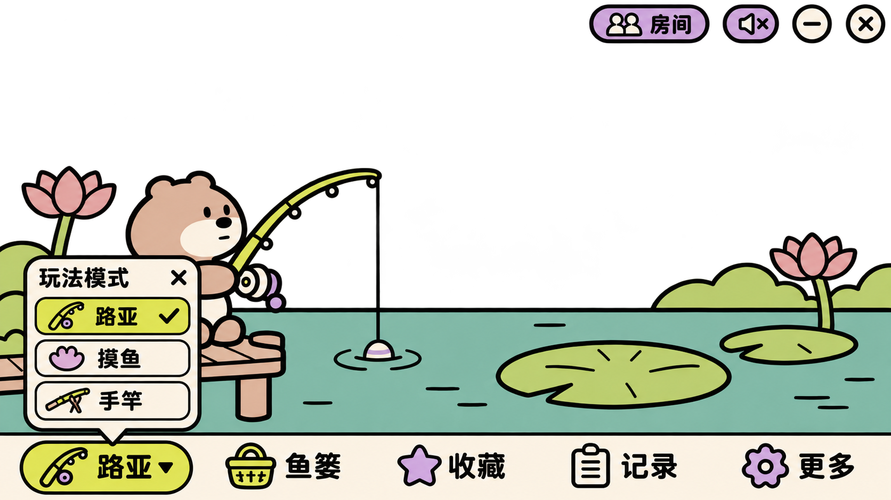
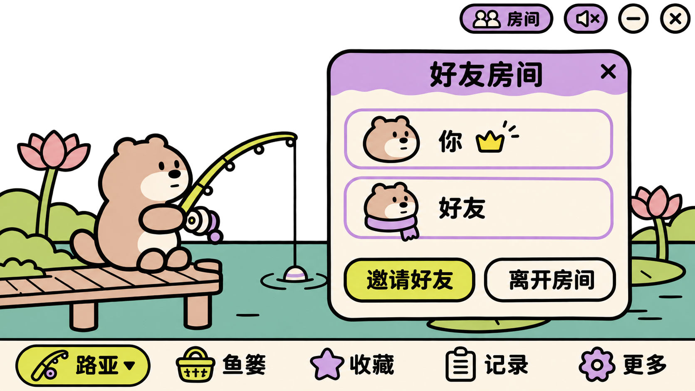
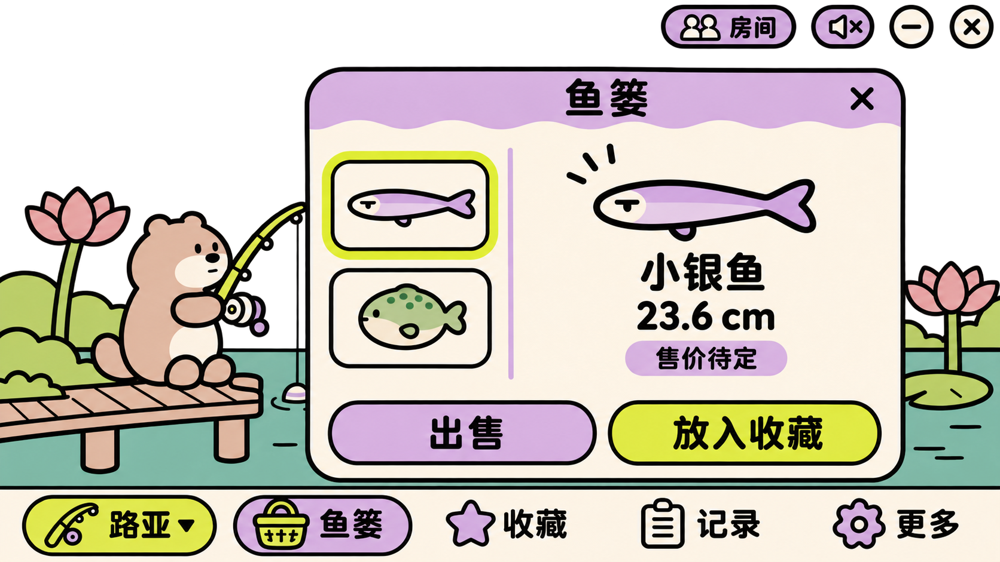
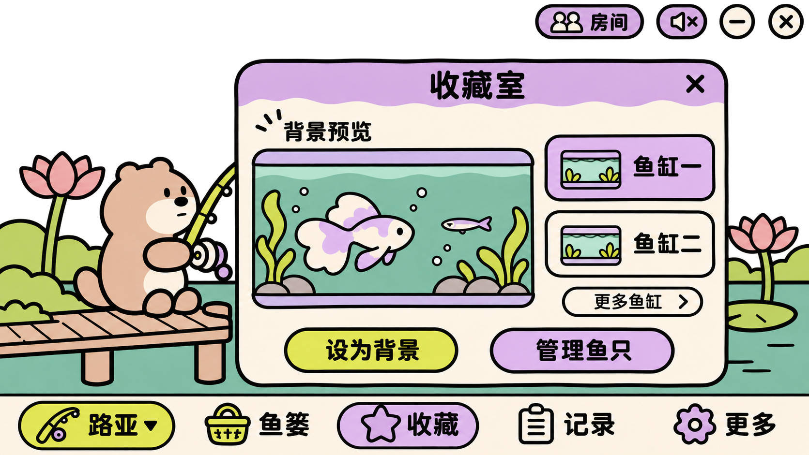
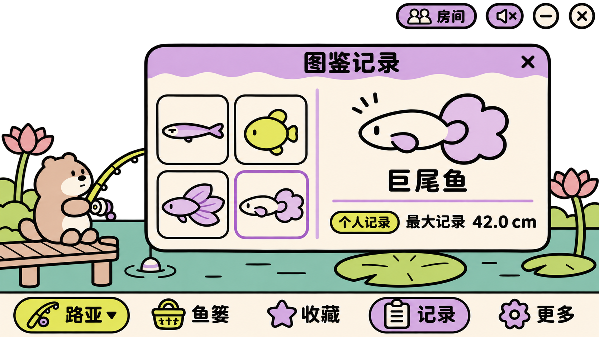
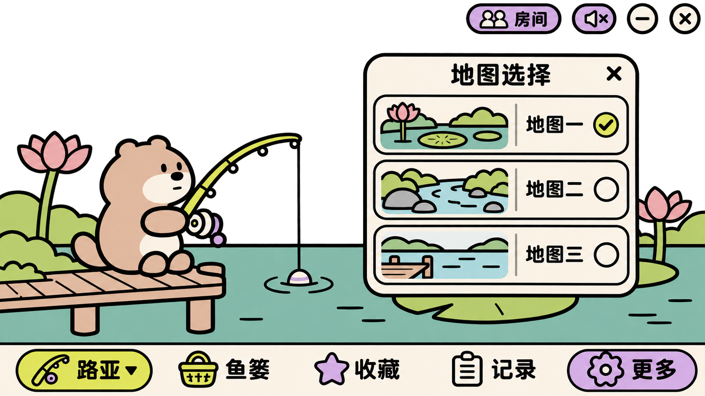

# 美术资产与参考图

系统编号：ART-001；单案修订：0.2；更新日期：2026-11-16。
规则状态：已选G风格与UI布局的制作参考；具体角色设定与物种内容未全部锁定。

## 1. 目标、职责与边界

采用G粗笔涂鸦方向，参考图作为构图、层级、轮廓和配色依据。保留原A—L评审作为历史，不把它们继续列为当前未选择风格；不覆盖原评审资料。

当前透明版优先于早期G板的紫色水面。采用参考中的原创伙伴识别特征，但不借此确定种族、角色名字或世界观，也不宣称已有商业IP授权。

## 2. 制作顺序

先锁角色/装备/鱼种母版 → 分层制作 → 接入日常动作和面板 → 实际小窗检查 → 验证高DPI与不同桌面底色。先用少量已批准鱼形验证尺寸，再按最终内容表扩展。

不要逐张重生所有角色来充当连续动画；输入动作通过同一批准母版派生，鱼获卡、鱼篓、收藏、图鉴引用同一鱼种资产。

## 3. 分层交付与命名语义

角色身体/头/前爪、摸鱼手套、鱼竿/线/浮漂、鱼、水面、岸边/装饰、主栏、右上独立控件、次级卡片、图标与文字分别交付。鱼体资源提供长度标定，所有个体用统一尺度驱动。

命名/文字母版【交文案策划定】；源文件层名可使用内部稳定ID，不把临时图中文字烘焙进正式控件。

## 4. 图像不变量与规则

- 粗黑略不规则轮廓、简化形状、克制表情、大色块。
- 留白真正透明；黑轮廓和角色奶油色块完整。
- 主栏与菜单实体区域正式制作时完全不透明；透明开关只影响命中，不改变美术alpha。
- 荷塘青绿水、自然绿叶、柔粉花；紫色只作少量UI/鱼体点缀。
- 左上无标题、无九点、无整条顶栏底板；顶右四个控件独立。
- 窗口几何固定16:9，生图宽高取整不决定实际窗口规格。

## 5. 参考图与菜单

所有图中文字、示例鱼名/长度、两人/两缸都仅为排版示例，均【交文案策划定】。08已补入用户选择的地图入口；09是新补的选择面板，三个占位名称不构成地图题材裁定。

### 透明主界面与鱼获轻提示

### 三种互斥模式入口

### 好友房间

### 鱼篓与主动处置入口

### 收藏室管理与背景预览

### 图鉴与尺寸记录

### 外观预览与抽取入口

### 设置与默认开启的穿透开关

### 更新后的更多菜单，包含地图

### 三地图选择，名称为占位

早期G风格板仅用于画法与原始轮廓参考，水色/窗口以当前UI为准：

## 6. 原图适用边界与生产统一

这些是AI效果图，不是可直接切图或运行的界面。部分菜单图里的角色尺寸、鱼形细节、线宽与底栏边距存在漂移；正式制作固定角色世界尺寸与共用底栏，不因打开面板把角色变成不同大小。面板允许遮挡部分场景，关闭后还原。

参考PNG的背景alpha已检查，但部分实体像素为253—254等近不透明值；正式控件使用完全不透明实体填色，抗锯齿边缘保留必要半透明。热区使用语义区域，不以AI毛边阈值自动决定。

原图1671/1672×941等宽高有取整偏差。实际窗口与制作画板按16:9执行，480×270是100%缩放下布局例子，不照搬原图像素为控件规格。

## 7. 资产记录与来源

- 本目录assets/ui为当前10张UI参考；assets/G-early-style-reference.png为早期G辅助板。
- [生成提示词记录](assets/生成提示词记录.txt)保留透明版初始生成记录。
- [补图提示词记录](assets/补图提示词记录.txt)保留新增地图入口与地图选择的提示词。
- [资源检查记录](assets/资源检查记录.md)列出尺寸、alpha检查和文件摘要。
- 生成方式为内置image_gen；PNG原始输出复制保留，没有用代码重画或改色。

## 8. 美术验收目标

- ART-01：在浅、深、复杂底色下透明空隙无整块底板，角色/卡片内部不误透明。
- ART-02：角色与装备母版跨动作一致，手套不会在不该出现的姿态自动新增。
- ART-03：同鱼种跨鱼获卡/鱼篓/收藏/记录保持同一鳍尾与识别色。
- ART-04：模式可由拉竿、探水、竿架等待三种姿态区分。
- ART-05：实际480×270示例下控件、鱼获和手套/竿尖可辨，字号不依赖放大图。
- ART-06：正式文字可替换、主栏/面板实体不透明、动作与反馈分层可复用。
- ART-07：同镜头鱼体长度比例与数据一致，缩略图不冒充实物比例。
- ART-08：更多菜单有地图入口；无左上标题/九点/整条顶栏。

## 9. 待定与来源

完整角色转面/比例、全部鱼种与命名、外观资产数量、连续动画、声音母版仍待后续制作/裁定。计划验收不等于已经在游戏内验证。

来源：美术选型会话、桌面界面会话、本轮三项用户答复及00裁定。

## 修订记录

0.2 / 2026-11-16 / G透明版为当前母版方向，补地图参考，保留文案和内容边界 / 用户选版 / 全专题 / PNG参考已生成，正式分层未制作。
